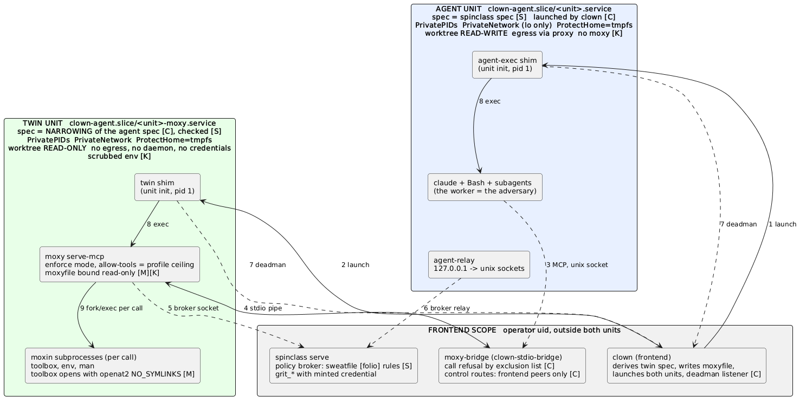

# Structural moxy for confined workers: the clown side (design, 2026-11-03)

Design note, no code. For the operator to approve before anything merges. The
spinclass side (FDR 0035 R3, the sweatfile resource rules) is spinclass/light-cedar's
note; this one covers what clown must build and change. Labels: **R** read in
code or docs this session, **I** inferred, **U** unverified or undecided.
Nothing here was built or run.

## Operator ruling (2026-11-03, relayed by the coordinator): V3 approved, V2 withdrawn

- **V3 is the direction.** Moxy stays in the agent unit; the allow-tools ceiling
  lives in the read-only global moxyfile; clown arms `MOXY_PARENT_MOXYFILE` and a
  pinned absolute `MOXIN_PATH`. No twin, no second unit. A moxin that must hold
  more than the unit has stays a frontend-class server.
- **V2 (sibling twin unit) is withdrawn, with no fallback.** Every section below
  that describes V2, its diagram, the least-privilege options A-D and the "stays a
  fallback" remarks is kept as the record of the analysis, not as a plan. Where
  the text says "fallback", read "withdrawn".
- **Default moxyfile for confined profiles: toolbox + env + man.** env carries the
  moxy#497 guards (merged in moxy, not deployed until the operator bumps moxy).
- **Answered (moxy/sunny-sumac, from source, FDR 0015 and bats; nothing run
  against a clown-written file, so verify with `moxy narrows --parent P --child C`
  before arming):** enforce accepts a clown-written moxyfile, no moxy change.
  Writer requirements: the parent is written with `moxy show-effective-moxyfile`
  (it records `resolved-moxins`; the narrowing check applies only when both sides
  carry that record) and clown pins the SAME absolute `MOXIN_PATH`; the child sets
  `permission-mode = "enforce"` (a non-enforcing child under an enforcing parent is
  a violation); parent `allow-tools = ["toolbox","env","man"]`, child a subset;
  `restart` is refused under enforce (drop it from the in-unit allow list);
  `enforce-allow` is not needed for toolbox/env/man. `man` and most `env` tools
  are always-allow; `toolbox.run` and `env.resolve` are dynamic (folio-perms
  floor, the broker answers first when armed), and which toolbox commands pass
  the floor is untested.
- **Still open:** whether the tool surface
  may ever be a boundary (needs a posture without Bash/Write/`run_recipe`, a
  just-us question; the operator is asked separately). Until then V3's ceiling is
  policy, not a boundary (spinclass#400).

## Status after the operator's challenge

The operator asked what a sibling twin (V2) buys over **in-unit moxy with a
protected ceiling** (call it V3). I re-checked from code (next section). Revised
view: **for tools whose authority is within the unit (toolbox, env, man, folio
reads), V3 is adequate and much cheaper; V2 buys little there.** V2 below is kept
as analysis only (withdrawn, see the ruling above): a moxy that must hold more
than the unit has should instead be a frontend-class server, by the existing pattern. I recommended V2
before checking how much moxy's in-unit holes matter against a worker that already
has the unit; that recommendation is withdrawn for the default moxyfile.

## Challenge: what does a twin buy over a hardened in-unit moxy?

V3 = moxy stays in the agent unit; the ceiling is the profile's `allow-tools`
written into the read-only global moxyfile; moxy's own narrowing is armed with
`MOXY_PARENT_MOXYFILE`; broker and toolbox `openat2` as today. Labels: R read in
code or docs this session, I inferred, U unverified.

### The decisive fact: the worker has the unit's whole authority without moxy

- The profile's `CLOWN_DISALLOWED_TOOLS` for `worker` does not list Bash, Read,
  Write or Edit (R, `builtin.toml`); FDR 0020 lists Bash network tools as
  available in the unit and the live-check runbook has the worker run `cat` from
  its Bash (R). Whether the sweatfile's `[claude] allow` actually permits Bash in
  a given unattended session is the operator's sweatfile (U; light-cedar asked
  the same).
- **Even with Bash denied there is another exec route (R):** FDR 0020 says "A
  confined worker with just-us can run any recipe in its justfile", and the worker
  can edit that justfile in its read-write worktree. `run_recipe` is therefore
  arbitrary exec with the unit's authority, and it is a worker profile's required
  server (R3 keeps just-us so `run_recipe` works).
- So no moxy tool, in or out of a twin, gives a worker authority the unit does not
  already give it. **The unit is the boundary; the tool ceiling is policy about
  which MCP tools are offered.** That is the operator's reasoning and it holds.
  It also means the sweatfile's `[folio]` read rules bind moxy's reads only: a
  worker with Bash or `run_recipe` reads whatever the unit's mounts show. If read
  rules must be structural, they belong in the unit's binds (the spec is
  spinclass's "what the unit must see"), with the broker as a finer layer on top.

### (1) Is the exclusion route the only way to widen the ceiling in-unit?

No. From code and docs:

| Route | Widens what | Status |
|---|---|---|
| `/clown/exclude-tools` on the in-unit bridge (FDR 0020, `agent-relay`) | clears the profile's **deny-list** (`context_excluded`) back to the `allow-tools` ceiling | R. Not a ceiling widening if the profile's ceiling is an allow-list in the read-only moxyfile; it only removes narrowing. Today the profile is only a deny-list, so today it IS the profile's whole expression |
| worktree moxyfile / `.moxy/moxyfile` (the worktree is the in-unit moxy's cwd and is worker-writable) | `allow-tools` can only narrow through the hierarchy (R, `IntersectAllowTools`, FDR 0020 InUnitMoxyfile text). It can add `[[servers]]` (a server's command is arbitrary exec) | R for the narrowing; **U** whether a planted `[[servers]]` named like an allowed bare name (`folio`) is served: moxy says "bare names are one namespace" (R, moxy FDR 0013) |
| `restart` (in `InUnitMoxyfile`'s allow-tools) | re-reads the hierarchy, so it picks up the worktree edits above | R. Judged only against `MOXY_PARENT_MOXYFILE`, which clown does **not** set for the in-unit moxy (R: the only non-test setters are juggler's) |
| `MOXIN_PATH` / `.moxy/moxins` | a planted moxin (moxy FDR 0013: "the one way a child can widen a tier or gain a moxin outright is a different `MOXIN_PATH`") | R for the mechanism; **U** whether the in-unit moxy's `MOXIN_PATH` is set in practice (it comes from the plugin's server env, not checked). The `agent home` the twin would also read is worker-writable, so V2 has the same planted-moxin question |
| env of the in-unit moxy | the relay starts it from `in-unit-servers.json`, bound read-only (R, `unit.go` `ServeFile`) | R: the worker cannot change what moxy is started with. It can start its own moxy; that is just a process |
| sibling processes | ptrace, signal, kill the in-unit moxy: same uid in the same unit pid ns (R: `PrivatePIDs` hides other units, not this one); Yama state **U** | R. No authority gain (moxy has the unit's), but the worker can make moxy do anything the unit can, ignoring its ceiling |

moxy has already built the answer for the file routes: `MOXY_PARENT_MOXYFILE`
(R, moxy FDR 0013) makes `moxy serve mcp` refuse to serve unless its effective
moxyfile narrows a reference read once at startup and pinned (so a later
`restart` is judged against it), and `resolved-moxins` pins moxin identity.
Clown does not arm it for the in-unit moxy today.

### (2) Is the grit_* concern solvable by the in-unit allow-list?

For **exposure**, yes, if (1)'s file routes are closed: an allow-list ceiling with
no `grit` in it, in the read-only moxyfile, pinned by `MOXY_PARENT_MOXYFILE`.
For **authority**, there is little to protect in-unit: a moxy `grit_*` call in the
unit is git run with the unit's rights, and the unit's refs are read-only and it
holds no credential (R, spinclass FDR 0035 round L: raw `update-ref`/commit fail
on the read-only refs; the credential cannot be read). What R3 guards is therefore
**spinclass's own grit policy** (stash refusal, force deny, FDR 0036) rather than
authority the unit lacks. I could not confirm that is R3's intended threat; it is
spinclass's rule and light-cedar can say (question below).

### (3) Minimum changes, V3 vs V2

| Repo | V3 (in-unit, protected ceiling) | V2 (twin) |
|---|---|---|
| clown | (a) a profile ceiling field written to the in-unit global moxyfile (`InUnitMoxyfile` becomes generated, still read-only) [small]; (b) render a parent reference and set `MOXY_PARENT_MOXYFILE` (absolute, outside every worker-writable path) plus an absolute pinned `MOXIN_PATH` for the in-unit moxy [small-medium]; (c) stop depending on `/clown/exclude-tools` for the ceiling | everything in V3's (a) and (b), **plus** a second-unit launcher, the narrowing function and its tests, a bridge whose child is a `systemd-run --pipe` client (not tried), a second deadman, a second socket, new peer classes |
| spinclass | R3' accepts an in-unit moxy whose profile reports the effective tool set with no `grit_*`; `catalogWidenings` compares the new field. **No broker change: the in-unit moxy is in the agent unit's cgroup, which the broker admits today (R per light-cedar, `policybroker_serve.go:133-147`)** | R3' with `placement=sibling`; broker peer class + record field; per-unit probes (F10/F13/F7...); stop/close/`staleUnits` for a second unit; no spec-narrowing input exists |
| moxy | confirm `MOXY_PARENT_MOXYFILE` under the in-unit `serve mcp` incl. a worktree `[[servers]]` and `.moxy/moxins` shadow (the earlier experiment E3 covered `serve-moxin` only, U); `openat2`-style opens for folio/rg/jq only matter if a moxy tool ever exceeds the unit | the same, and `serve mcp` behind the twin |

V3 is two repos plus a moxy confirmation; V2 is three repos plus new unit
machinery in spinclass. I did not size either beyond this.

### (4) What V2 covers that V3 does not

| Threat | V2 | V3 | Matters here? |
|---|---|---|---|
| ptrace / `/proc` / signalling of moxy by the worker | separate pid ns (R) | possible (same unit); Yama U | only for integrity of moxy's decisions. The worker has the unit's authority anyway |
| resource exhaustion | own cgroup budget (the agent unit has 6G / 4096 tasks / 400% shared with moxy, R) | shared, so a runaway worker starves its own moxy | availability of the worker's own tools only |
| compromised or planted moxin binary | no: the twin reads the same worker-writable agent home, so it needs the same `MOXIN_PATH` pin | no, same pin | equal, both need `resolved-moxins` |
| a moxy tool with more authority than the unit | the twin could hold less than the unit (read-only worktree) | no | **this is the real V2 case, and it is not the default moxyfile**: toolbox/env/man are read-only compute within the unit's view. Tools that exceed the unit stay frontend-class (R: `frontendMoxins`) |

So V2 mainly buys integrity against a worker who tampers with its own moxy, and
that gains nothing while the worker has Bash or `run_recipe`.

### The algebra question

Operator: one permission-resolution model (grants as values, combined by a meet)
instead of point rules across profile, sweatfile, broker and unit spec.

- **It already exists in two places, as one relation**: moxy's narrowing relation
  (`pkg/narrowing`, a child `<=` parent, R) and spinclass's `catalogWidenings`
  (R per light-cedar) are two implementations of "child narrows parent" over
  different domains (tools; profile fields). Unit-spec narrowing has none.
- **Where a meet fits:** the sets (tool names, anchors, bind lists, egress hosts)
  combine by intersection, and the "profile narrows a base" checks are `<=`. A
  shared `narrows` over those would give V2 the missing "twin spec <= agent spec"
  check and give both paths one definition of "never widens".
- **Where it does not:** light-cedar's point stands: the broker's verdicts are
  allow/ask/deny per evaluated layer then the minimum, which is a per-request
  decision, not a merged grant value. A single lattice over all of it would be a
  large cross-repo abstraction for decisions that differ in kind.
- **Does it simplify either path?** Mostly V2 (it removes the "no input for a
  narrowing check" gap). V3 needs little more than moxy's existing narrowing plus
  one profile field. I would not gate either path on it; adopt it incrementally as
  the shared `narrows` relation if spinclass and moxy want it. I did not design it.

### Revised recommendation (I)

1. **V3 for the default moxyfile** (toolbox, env, man): in-unit moxy, profile
   ceiling as an allow-list in the read-only moxyfile, `MOXY_PARENT_MOXYFILE` and a
   pinned `MOXIN_PATH` armed by clown. No broker change. Drop the dependence on
   the in-unit exclusion route for anything that is meant to be a ceiling.
2. **Anything beyond the unit stays a frontend-class server**, one per authority,
   as `issue-filer` is.
3. **If the operator wants the tool surface itself to be a security boundary**,
   that needs the worker to lack Bash, Write/Edit and `run_recipe` over an
   editable justfile; that is a posture and a just-us question, not a moxy one,
   and it is the thing to decide before choosing V2 for its own sake.
4. **Read rules as structure** belong in the unit's binds; the broker is the finer
   layer. That is spinclass's spec.

### Spinclass's answers to the three questions (light-cedar, as reported)

1. **R3 is policy, not authority.** FDR 0035 R3 calls itself "the grit tool-kind
   right, the first hard-coded instance of the rights the moxy frontend will
   enforce" (R). Moxy's grit would bypass spinclass's ownership model (FDR 0036:
   stash refusal, force deny, branch ownership), not reach a credential: the
   minted credential is outside the unit and refs, logs, config and hooks are
   read-only (R, `buildUnitSpec` comments). My reading was right.
2. **The `[claude] allow` rules are worker-writable today.** They are written to
   `<worktree>/.claude/settings.local.json` at session creation
   (`sweatfile.ApplyClaudeSettings`, `apply.go:261`), inside the read-write
   worktree bind (R). FDR 0035 records it as a worker-writable file the
   harness consumes, tracked as spinclass#400, open. Whether claude re-reads it
   mid-session or only at (re)start is U; a restart picks up a planted file
   either way. The worktree `.mcp.json` is the same. So under dontAsk the allow
   list is policy, not a boundary, until #400 closes: the tool surface is not a
   boundary against the worker, which is the V3 framing.
3. **R3' would accept an in-unit moxy whose profile reports its tool set**, as a
   design: reported set present, no `grit_*`, just-us kept; the placement report is
   unnecessary for V3. Not built: it needs clown's profile field and spinclass's
   `catalogWidenings` comparing it (until then a new field is unchecked).
   **Caution to carry:** the reported set is clown's claim about the moxyfile it
   armed; the worker can still exec another moxy in the unit. R3' is then an
   honest check of the profile and a guard against a confused worker. **This note
   must not call it structural**, and V3's ceiling is not either.

## The directive

Operator, via circus/eager-holly (2026-11-03): confined workers need to reach
moxy, and **only** the mcps defined by the profile's moxyfile and the resource
rules defined by the sweatfile. It must be **structural**: reaching more than
that should not be possible from inside the confined unit. Moxy plus toolbox is
the default for all profiles. (`57ce758` already enables toolbox in the
non-worker templates and in the in-unit moxyfile; this note is about `worker`
and `canary-spinclass`, which drop moxy whole.)

## Where we are (R)

- A confined spawn today must drop `moxy/moxy` whole and keep `just-us`
  (spinclass `checkConfinedToolSurface`, FDR 0035 R3). Reason on record: the
  rule wants no moxy `grit_*` reachable, and in-unit exclusions are "policy, not
  a boundary" (clown FDR 0020, the exclusion paragraphs): an in-unit moxy and its
  bridge run in the worker's unit, so the worker can reach its own
  `/clown/exclude-tools` on loopback. clown#301 closed the same hole only for
  the spinclass-serve bridge (its control routes answer 403 to the unit).
- A confined session that keeps moxy gets it **inside** the unit
  (`startInUnitServers`, `agent-relay`), under `agentscope.InUnitMoxyfile`
  (an `allow-tools` ceiling, read-only bind). FDR 0020 says why not the
  frontend: "A frontend moxy would be a ProtectHome bypass through
  `folio_write`."
- Frontend-class servers (ringmaster, troupe, spinclass serve, the
  `clown-builtin-moxins` issue-filer) run outside the unit with the operator's
  authority and reach it over a forwarded socket. A moxin served that way "must
  have no filesystem or exec effect for its caller" (`frontendmoxin.go` header).
- The unit's view (R, FDR 0020 unit properties, `agentscope/spec.go`):
  `ProtectHome=tmpfs`, `PrivatePIDs=yes`, `PrivateTmp`, the worktree and
  `binds_rw`/`binds_ro` from the spinclass spec, `HOME` = an agent home under
  the worktree (default `<worktree>/.tmp/agent-home`), loopback unreachable,
  sockets bound in as single inodes.
- The sweatfile rules reach moxy as the policy broker: `spinclass serve` listens
  on a per-session socket, clown names it in `CLOWN_POLICY_BROKER`
  (`brokersocket.go`), confined it is relayed to `127.0.0.1:19001` in the unit.
  moxy#490/#500: folio, rg, jq and toolbox ask it per file operand.

## Why the obvious design fails the directive

"Run one full moxy in the frontend, reachable only over the unit's socket" is
what the directive's wording suggests. As a plain frontend process it does not
make "more than defined" impossible:

1. **Wrong file view (R).** A frontend moxy sees the operator's filesystem, not
   the unit's. `~` is the operator's home there, not the agent home (moxy FDR 0016 says
   that in a confined unit `~` means the unit's agent home; a frontend moxy
   has no way to know that on its own, I). The only thing then keeping it off
   the operator's files is the broker's verdict on a **path name**.
2. **Symlinks (R for the premise, I for the exploit).** The worktree is writable
   by the unit. A worker plants `link -> ~/.ssh/id_x` in it; the path the broker
   judges is inside the worktree, the file the frontend opens is not. moxy#490's
   own text says `folio.read` follows a symlink leaf today; toolbox opens with
   `openat2(RESOLVE_NO_SYMLINKS)`, folio, rg and jq do not. Fixing that in every
   tool is moxy's lane and would make safety depend on every path-taking tool
   in the catalog being right.
3. **Unreviewed tools (R, moxy FDR 0015).** Under `permission-mode = "enforce"`
   a tool with no declared tier is refused, which is the safe default, but the
   guarantee is exactly "as good as every tool's resource declarations". That is
   a policy argument, not a structural one.

So a plain frontend moxy trades the unit's mount namespace, which is a boundary,
for path-name policy, which is not. I recommend against it.

## V2: moxy in a sibling unit, same view, outside the worker's reach (I; WITHDRAWN by the operator, no fallback; kept as analysis)

Serve moxy from a **second transient service** that clown starts next to the
agent unit, instead of inside it or in the frontend:

| Property | Agent unit (today) | Moxy unit (proposed) |
|---|---|---|
| Spec | spinclass spec | the **same** spec (same binds, `ProtectHome=tmpfs`, agent home, deny paths) |
| Filesystem view | the spec | the spec, by construction (so `~`, symlinks and the worktree resolve exactly as for the worker's own tools) |
| pid ns | `PrivatePIDs=yes` | its own `PrivatePIDs=yes`: the worker cannot see or ptrace it |
| Config the worker could touch | InUnitMoxyfile read-only bind, but exclusions pushed to a route the worker can reach | moxyfile and exclusions written by the frontend into clown-owned state that is **not** a bind of the agent unit; control routes answer the unit 403 (the #301 peer-class mechanism) |
| Reach into the worker's unit | n/a | one unix socket bound **into** the agent unit as a single inode (the existing Sockets mechanism) |
| Permission mode | delegate (hook in front) | `enforce`, plus the broker (the sweatfile rules) |

What this buys, against the directive:

- **"Only what is defined":** the effective tool set is the moxyfile
  `allow-tools` clown writes (profile ceiling intersected with the in-unit
  ceiling), enforced by the proxy, not by a list the worker can reach. The
  frontend reads the effective list back through the control route (the
  readback FDR 0035 R3 calls "form (ii), not built, waits on the frontend
  proxy").
- **"Structural":** the moxy process, its config, its exclusions and its
  control routes are outside the worker's pid and mount namespaces. Its file
  authority is the unit's, not the operator's, so even a bug in a tool's path
  handling cannot reach what the unit cannot reach (the symlink case resolves
  into the hidden home and fails).
- **Same uid is not a hole here (R, FDR 0020):** the agent unit's `PrivatePIDs`
  already hides every other process of that uid; the moxy unit is one more
  process it cannot see.

What it costs:

- A second unit per session: lifecycle (start before the agent, stop with the
  session, die when the frontend dies, the same deadman as the agent unit),
  startup latency, a second cgroup under `clown-agent.slice`, and spinclass's
  confinement machinery, which assumes one unit per session (R per light-cedar:
  the unit record carries one Unit/Cgroup/ServeSocket; F11 iterates one record
  per live session; `staleUnits`, `stop.go` and `close_signal.go` act on
  `rec.Unit`; F10, F13, F7 and the rest probe only the agent unit, so **nothing
  probes the twin today**, and the deadman alone is not a close).
- Not everything moxy does is reachable with the unit's authority. That is the
  point, but it means: git remote operations still go through spinclass serve's
  frontend grit; nix builds still go through the daemon socket the spec binds;
  the broker socket must be bound into the moxy unit too (today it is relayed to
  the agent unit on `127.0.0.1:19001` because its network is private; a unix
  socket bind is simpler for the moxy unit).
- The in-unit moxy's hook logger, `CLOWN_SESSION_ID` gap and async-job
  limitation (FDR 0020, "What a confined worker loses") carry over or need a
  line; a moxy unit that is clown-started could be given the session id.

## V2 diagram

Source `2026-11-03-structural-moxy-confined-v2.puml`, rendered with
`just explore-render-plantuml docs/plans/2026-11-03-structural-moxy-confined-v2.puml`
to `2026-11-03-structural-moxy-confined-v2.png` (rendered and looked at, not
only parsed). Boxes are units and processes; numbers key into the tables.

### Edges (who can connect, and what checks them)

| # | Edge | Mechanism | Who can connect | Check, and where |
|---|---|---|---|---|
| 1 | clown starts the agent unit | `systemd-run --user --pipe --collect` with the pty slave as stdio (R, FDR 0020) | clown only | required unit properties; clown refuses to launch if one cannot be applied (R) |
| 2 | clown starts the twin | same launcher, twin spec, `BindReadOnlyPaths=` of the moxyfile directory (I) | clown only | same. clown derives the twin spec by a pure function of the agent spec (read-only worktree, no egress, fewer sockets) with a clown test that it only narrows (I). Spinclass does **not** check a twin spec: it writes the one spec and never sees a derived one (R per light-cedar); it would probe the RUNNING twin instead (new F-rows, not built) |
| 3 | agent to moxy-bridge | unix socket created by the frontend bridge, bound into the agent unit as one inode (R: the serve-socket pattern, `ServeConn.Frontend`) | processes in the agent unit's cgroup | frontend end checks `SO_PEERCRED` and `/proc/<pid>/cgroup` (R). `/mcp` and `/healthz` open to the unit; `/clown/exclude-tools` and `/clown/system-prompt` answer 403 to the unit and to a peer with no class (R, FDR 0020, clown#301) |
| 4 | bridge to moxy | the stdio of `systemd-run --pipe ... moxy serve-mcp`: no socket exists | only the frontend holds the pipe; the agent cannot name it and cannot see the twin's pid ns (R for `PrivatePIDs`) | none needed beyond the kernel. **U:** the bridge today wraps a stdio child it starts itself; a child that is a `systemd-run --pipe` client (its lifetime, its signal handling, one child shared by all connections) is not tried |
| 5 | moxy to broker | unix socket where `spinclass serve` listens, bound into the twin as one inode (I; the agent unit gets the same broker by a loopback relay, R) | the twin's processes | the broker's peer check (R: `peercheck`, spinclass links it). **Today the broker refuses a twin** (R per light-cedar, `policybroker_serve.go:133-147`): it admits `SameUID` plus a pid in the agent unit's cgroup (`CheckUnitCgroup(pid, rec.Unit)`), and a confined launch whose record is unreadable admits nobody. Refused until a spinclass change and a record field naming the twin unit/cgroup both land (the record is clown's format, `LoadUnitRecord`). Broker down means moxy falls to its static floor, never to allow (R, moxy FDR 0016) |
| 6 | agent to broker | loopback `127.0.0.1:19001` relay to the same socket (R, `brokersocket.go`) | the agent unit | unchanged |
| 7 | deadman | shim connects to the frontend's socket before anything else; EOF means kill the unit (R, FDR 0020 #319) | one connection per unit | frontend peer-checks the cgroup (R). The twin needs its own; **U:** the second listener |
| 8, 9 | shim execs claude / moxy; moxy forks a moxin per call | process exec inside each unit | in-unit | the moxin inherits the twin's view and nothing else (I; moxin commands are per-call subprocesses, R, `run.toml`) |

### The two units and the frontend

| | Agent unit | Twin unit | Frontend |
|---|---|---|---|
| Namespaces | private mount, pid, net (lo only), devpts, tmp | same set, own instances | host |
| Worktree | read-write | **read-only** (I) | n/a |
| Operator home | hidden (`ProtectHome=tmpfs`); `HOME` = agent home | hidden; same agent-home path readable, same `HOME` so `~` agrees (spinclass: broker maps `home:` to the agent home, R per light-cedar) | the real one |
| Egress | proxy only, allowlist from the sweatfile | none (I) | n/a |
| Sockets in | S1, relays, serve socket, deadman, idle, monitors | broker B, deadman | creates all |
| Credentials | none (ssh agent only if the spec passes it) | none | all |
| Env | scrubbed allowlist | scrubbed; no frontend env, no `CLOWN_SESSION_ID` (I) | full |
| Limits | `MemoryHigh` 6G, `TasksMax` 4096, ... (R) | own, smaller (I, not designed) | n/a |

### Where each rule is enforced

| Rule | Enforced by | Fails closed how |
|---|---|---|
| The twin's spec never exceeds the agent's | clown derives it by a pure narrowing function with a clown test (I); spinclass does not check the spec but would probe the running twin (new F-rows, not built) | refuse to launch, no moxy |
| The twin cannot write, reach the network, read the home or see the worker | kernel/systemd: RO bind, `PrivateNetwork`, `ProtectHome`, `PrivatePIDs` (R for the properties on the agent unit; the twin is the same builder, U) | the property is required, launch refused |
| Only the profile's tools exist | moxy `allow-tools` from the moxyfile (R), enforced again by the frontend bridge's call refusal (R for the pattern) | a tool not listed is absent |
| Read paths follow the sweatfile | broker, `[folio]` rules (R per light-cedar); `toolbox` re-asks and opens with `openat2(RESOLVE_NO_SYMLINKS)` (R, moxy FDR 0016); folio, rg, jq do not (R, moxy#490) | a denied path is refused; no broker falls to the static floor |
| The worker cannot widen the ceiling | moxyfile is a read-only bind from clown state (I); exclusions and refusal live in the frontend (R pattern); control routes refuse the unit (R) | nothing in the unit can write either |
| The profile's effective tool set has no `grit_*` | R3' in spinclass: profile resolution reports the set, no report means refuse (R per light-cedar; needs the profile field) | spawn refused |

## Least privilege: is every moxin as privileged as the hungriest one?

Short answer: **in one twin, yes**, for the process and its view. All the moxins
in it share one filesystem view, one network (none) and one set of sockets, so
the twin must hold what its most demanding tool needs. What follows is how far
that is bounded, and what the options cost. Labels as above; none of it measured.

### What bounds the twin (I)

1. **The twin is a narrowing of the agent unit**, so everything it can reach
   the worker can already reach with Bash and the native file tools in its own
   unit (R: FDR 0020 lists Bash and the native tools as available). Adding the
   twin gives the worker no filesystem or network authority it lacks. The
   "maximum" is capped by the agent unit, not by the hungriest moxin in the
   catalog.
2. **Tools that need more than the unit never join it.** The credentialed or
   host-reaching moxins stay separate frontend servers, each with its own scope:
   issue-filer (a token), smith (forge credentials, absent in confinement),
   chrest (the browser), the Google moxins. That is already "one small server per
   moxin" (R: `frontendMoxins`), outside the unit.
3. **The default moxyfile is one class.** The operator's default is `toolbox` +
   `env` + `man` (rg and jq may fold into toolbox, moxy#502). These read files
   under the unit's view and do nothing else (toolbox is read-only by its
   annotation, R; `env` and `man` I, I did not read their annotations). One
   **read-only twin, no network, no sockets but the broker** is their greatest
   common denominator, and it is below the agent unit's privilege.

### Options

| Option | Least privilege it reaches | Cost | What fails closed |
|---|---|---|---|
| **A. One twin, all hosted moxins** (recommended to start, default moxyfile only) | the max over the hosted tools, capped at the agent unit; shared view | 1 extra unit per session; one more deadman, spec check, cgroup limits; startup latency unmeasured | unit does not start: no moxy. A tool that needs more than the twin has gets `EROFS`/`EACCES`; the twin cannot be widened at run time (spec fixed at launch). Inside the twin, which tool runs is moxy policy, and a bug in a hosted tool acts with the twin's authority |
| **B. One twin per privilege class** (e.g. read-only; worktree-write; nix daemon + egress) | each class's max. A read tool never shares a process or view with a write or network tool | 2-3 units per session; each class is a separate MCP server, so the worker's tool names and the profile's `context_servers` change (`moxy-ro`, `moxy-rw`), one moxyfile and ceiling per class | each unit independently; a class that cannot start is simply absent |
| **C. One tiny unit per moxin** (the `clown-builtin-moxins/issue-filer` shape, `moxy serve-moxin --name X`, R) | exact per-moxin: a moxin gets only the binds and network it declares | N units per session (3 for the default moxyfile); N deadmen, N cgroup budgets, N startups; **U:** moxins declare no needs (binds, sockets, net), so a per-moxin spec has no source today: it is new moxin metadata in moxy's lane | each unit independently; a moxin with no declared needs gets the narrowest default (I) |
| **D. Per-call sandbox inside one twin** (a launcher wrapped around each moxin command: Landlock, seccomp or a bind subset) | per call: a moxin subprocess gets only its own paths and syscalls. The long-lived moxy proxy keeps the union | no new units; a wrapper in each moxin's `command` (moxy's lane), fork and ruleset setup per call, unmeasured. **U:** Landlock availability in the kernel build (the host reports Linux 6.12.76 in this session's environment, V; the build config was not read) | only if the wrapper aborts when it cannot apply the ruleset; a wrapper that falls back to running unsandboxed fails open, so that must be a design rule |

Recommendation (I): start with A for the read-only default, and **only** that
class. Add B when a profile names a tool that needs write or daemon authority
(and ask first whether the worker's native tools already cover it: the
unit has Write/Edit, and the chix tools in porter's keep set are the daemon users).
Keep credentialed moxins as C-style frontend servers, as today. Treat D as
defense in depth that moxy can add independently; it composes with any of A-C
and is the only one that narrows within a single twin.

What does **not** become structural under any option: moxy's allow-list inside
the twin is policy relative to a bug in a hosted tool. The structural part is the
unit boundary (what the twin can touch at all) and that the worker cannot reach
or change the twin, its config or its refusals.

## The profile's moxyfile as the ceiling (U, needs a decision)

A profile today is `context_servers` (keep servers) plus `context_excluded`
(a **deny**-list per server). That is not a ceiling: a tool nobody listed
(`toolbox_run`, or a tool a later moxy adds) is on. For the directive we need an
allow-list the moxy unit enforces. Three shapes:

1. **A profile field** (e.g. `moxy_allow`), written into the moxyfile as
   `allow-tools`. Honest and explicit; adds a field to `profilelookup`'s
   canonical form, so a `ProtocolVersion` bump announced to spinclass first
   (AGENTS.md: that package is spinclass's), and a registry-stamp consideration
   for older clowns reading `profiles.toml`.
2. **Derive it** from the keep-set against moxy's catalog at launch
   (`catalog minus context_excluded`). No schema change, but it makes a moxy
   upgrade silently widen the ceiling (new tools appear), which is the opposite
   of structural. I do not recommend it for the confined path.
3. **The sweatfile owns it** (spinclass's note): the profile only names
   `moxy/moxy`, the sweatfile names the tools. Then clown's profile need not
   change; it moves the ceiling to spinclass's trusted layers (like
   `spawn-profile`, read only above the repo).

My preference is (1) for clown plus (3)'s trust rule: the profile proposes, the
trusted sweatfile may only narrow, and the moxy unit's effective list is the
intersection. This is the same shape as the user-profile "narrows a builtin"
rule spinclass already enforces (Tier 1), but `catalogWidenings` lists the
fields it compares explicitly, so a new `moxy_allow` is **not** compared until
spinclass adds it (R per light-cedar). Until then a user profile could widen the
ceiling unchecked. The change is small and test-first on their side and must land
with or before clown's field.

## What clown has to change (R for locations, I for the changes)

1. **A second-unit launcher** next to `runInAgentScope`
   (`cmd/clown/agentscope.go`): the narrowed spec (a pure function, tested), different command (`moxy serve-mcp`
   behind the stdio bridge), no pty, a unix socket output. Reuses
   `prepareAgentScope`; the unit properties are the agent unit's.
2. **The socket into the agent unit** (`Spec.Sockets` / the serve-socket
   pattern, `ServeConn.Frontend`): the bridge tags peer class; control routes
   refuse the unit; `/mcp` stays open to it.
3. **`InUnitMoxyfile` stops being an in-unit file.** The ceiling moves to
   clown-owned state the frontend writes before the moxy unit starts. The
   constant remains the default ceiling; `57ce758`'s `toolbox` entry carries
   over.
4. **The exclusion push** (`applyInUnitExclusions`, readback file) becomes a
   frontend push over the control route plus a frontend readback, not an
   in-unit record.
5. **Profile templates:** `worker` and `canary-spinclass` keep moxy with a real
   `moxy_allow` (no `grit_*`, `toolbox_run` in); the partition test and the
   "worker must drop moxy whole" test change **only after** spinclass's R3
   changes. I have not touched either. Server name: R3's test keys on the exact
   name `moxy/moxy` (`confineprofile.go` `moxyServer`), so R3' could not tell an
   in-unit moxy from the twin by name. Proposal (spinclass's preference):
   profile resolution reports **(a)** the effective tool set and **(b)**
   `placement=sibling`; clown guarantees a confined launch never starts an
   in-unit moxy when the profile reports sibling; R3' accepts only if both are
   reported and the set has no `grit_*`, and refuses anything else. The
   alternative, a distinct server name for the twin, needs `claude.allow`
   entries or a hook change (below). Not decided.
6. **Docs:** FDR 0020: the "Consumer" table row for moxy (it is no longer "inside
   the unit as claude's stdio child"), the sentence "A frontend moxy would be a
   ProtectHome bypass" (replaced by why a sibling unit is not), the
   exclusions-are-policy paragraphs (true only for non-sibling in-unit servers),
   the "What a confined worker loses" moxy rows (most become available through
   the ceiling), and F12 (the control routes rule now covers the moxy unit).
   `docs/plans/2026-10-26-confined-moxy-sequencing.md` line 41 still says
   clown#301 is open; it is closed for the serve bridge only.

## Alternatives considered

- **Plain frontend moxy** (the directive's literal wording): rejected above.
  It would be acceptable only if every path-taking tool in the profile's
  ceiling were proven no-symlink and resource-declared; that is a per-tool audit
  in moxy's lane and not structural.
- **Keep moxy in the agent unit, make exclusions a boundary**
  (spinclass#383 per-tool add-back plus a read-only exclusion route): needs the
  bridge in the worker's unit to be untamperable, which it is not (same pid ns,
  same uid inside the unit). A boundary needs a different process owner.
- **A toolbox-only in-unit server** (my earlier option (a)): still the cheapest
  way to get `toolbox_run` into `worker` alone, but it does not answer "moxy for
  confined workers". With V2 withdrawn this is not a fallback either; V3 covers it.

## Spinclass's answers (light-cedar, 2026-11-03; their note: spinclass
`docs/plans/2026-11-03-structural-confined-moxy.md`, commit 808155c, branch only)

They call this design V2 and recommend it as the boundary; they add V1 (broker
floor with a resolved-realpath check, plus `openat2` in moxy) as an interim and
defense in depth. Their answers, as reported, not re-verified by me:

- **(a) Units:** the spec is one JSON with one unit name hint and one result
  record per worktree. They did not read every confinement-check row and infer
  the checks assume one unit per session. A twin needs a second result path, or
  clown launching it from the same spec without a second spinclass record (my
  call). The protected-bind and probe checks run on the spec, so one spec covers
  both units.
- **(b) Sweatfile `[folio]`:** anchors, not only host paths: `pwd`, `home`,
  `env:`, `nix-store`, `spinclass:{worktree,repo,worktrees,children,siblings}`,
  `madder:`. Evaluated only by `spinclass serve`'s broker. In a confined session
  `home:` means the unit's agent home (the broker already maps it), so the twin
  must set the same `HOME`.
- **(c) Ceiling ownership:** split. The tool ceiling (moxyfile `allow-tools`) is
  the profile's, clown-owned; the resource rules are the sweatfile's, spinclass-
  owned. Neither may come from inside the unit. This settles shape 1 above for
  the tool ceiling; shape 3 is not wanted for tools.
- **(d) R3:** becomes R3': keep the "no in-unit `moxy/moxy`" test and `just-us`;
  if the frontend moxy server is kept, profile resolution must **report** its
  effective tool set, which must contain no `grit_*`; no report means refuse. That
  needs the new profile-protocol field, announced to spinclass first. Spinclass
  changes nothing in R3 until clown reports it.
- Unverified on their side: moxy's `serve-mcp` config discovery (the cwd/moxyfile
  experiment covered `serve-moxin` only), that the twin can reuse the agent-unit
  property builder, and the context cost.

Consequence for the ceiling: the profile gets an explicit tool list field
(shape 1) and `profilelookup` reports the effective set; the sweatfile does not
supply tools. The "hybrid with intersection" preference above is dropped.

## Corrections from spinclass's review (light-cedar, on 054f655)

Five points where my first draft was wrong or too optimistic; the sections above
now say so. Checked by light-cedar against spinclass code, not re-read by me.

1. The broker refuses a twin today (peer check is the agent unit's cgroup); it
   needs a spinclass change and a unit-record field naming the twin.
2. Spinclass does not check a twin spec; `catalogWidenings` compares profiles,
   not unit specs. The honest design is a pure derivation function in clown with
   a clown test, plus spinclass probing the running twin.
3. The confinement checks, `stop`, `close` and `staleUnits` assume one unit per
   session; the twin needs its own record entry, probe set and stop path.
4. A new profile field is not compared by `catalogWidenings` until spinclass adds
   it.
5. R3' cannot tell the twin from an in-unit moxy by server name; use the explicit
   report (tool set plus `placement=sibling`).

Confirmed: `home:` in a confined session maps to the agent home (the twin must set
the same `HOME`); `[folio]` is evaluated only by `spinclass serve`'s broker; the
option recommendation (A for the read-only default, B on demand, credentialed
moxins stay frontend, D as defense in depth with abort-on-failure).

Flagged, unresolved (inferred by spinclass, not checked):

- **A read-only twin versus cached results.** moxy streams large results into the
  madder blob store and tools take `madder://blobs/<digest>` back (chaining).
  A read-only twin cannot write blobs unless the madder store is bound writable.
  Where results land is undecided; it is an authority the twin would then hold.
- **The hook's moxy read allow list (#372)** matches the existing plugin prefix; a
  twin under another server name needs `claude.allow` entries or a hook change
  (operator question 4, unruled).

## Open questions

- (clown) Second result path vs launching the twin from the same spec with no
  second spinclass record: the second keeps spinclass's checks honest, the first
  is less spinclass work. Undecided.
- (operator) Approve shape 1 (profile field) and V2 as the boundary with V1 as
  the interim? A `profilelookup` protocol bump needs announcing to spinclass
  before it lands.
- (moxy) Does `moxy serve-mcp` take everything needed from a clown-written
  moxyfile under `permission-mode = "enforce"` with the broker (moxy FDR 0015)?
  `enforce` refuses `restart` and any unannotated tool; the in-unit ceiling lists
  `restart`, `batch` and `async`.
- (clown, later) Whether the moxy unit should be shared by a session's spawned
  children or one per unit; the directive says one per unit.

## Not claimed

Nothing here was run. Whether a second unit with the same spec starts reliably,
whether the socket bind into the agent unit behaves as the serve socket does,
and the startup cost are all unmeasured. `just verify-agent-scope` has no case
for any of it.
